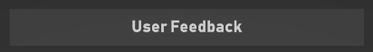
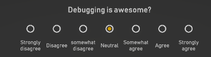
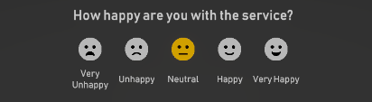
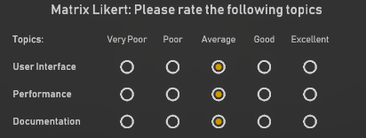
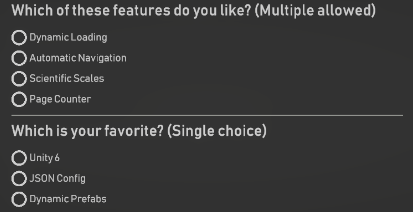
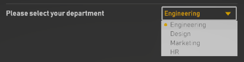
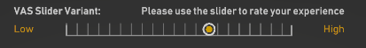
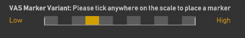

<p align="center">
  
</p>

# EDIA Survey Toolkit

This system allows for dynamic generation of surveys from JSON configuration files or ScriptableObjects in Unity.

# Features
- **Configurable**: Use the same JSON config for multiple surveys.
- **Dynamic UI Generation**: Creates UI survey components based on JSON configuration. No need to create prefabs manually.
- **Automatic Results Collection**: Collects results automatically, logs them to a JSON file. 

# Installation
Import the package via the Unity Package Manager.

Use the following path: 'https://github.com/edia-toolbox/edia_survey.git?path=Assets/com.edia.survey'

# How to Use
1. Drag the prefab 'SurveyPanel' under a canvas object. 
2. Define your survey by setting up the JSON config file. (see below)
3. Drag this file into the 'Survey json' field.
3. Link the `onFinished` UnityEvent to any cleanup or transition logic, the `OnFinishedResult` also provides the results as JSON string.

### OR
- Generate an scriptable object for the survey configuration via 'Create -> EDIA -> Survey -> Survey Configuration' and drag it into the 'Survey Configuration' field.
- Call the `Init(string json)` method on the `SurveyManager` script to initialize the survey from a JSON string.`

## Config JSON Structure

```json
{
  "surveyId": "my_unique_survey_id",
  "pages": [
    {
      "id": "page_01",
      "components": [
        {
          ...
        },
        {
          ...
        }
      ]
    },
    {
      "id": "page_02",
      "components": [
        {
          ...
        }
      ]
    },
    
    ...
    
  ]
}
```
# Components

Each component type in the JSON configuration defines a specific UI element in the survey.
The `type` field defines the type of component and is used to determine which UI element to create.


### Header
For displaying section headers.



```json
{
  "id": "header",
  "type": "header",
  "text": "User Feedback"
}
```

### Text
For displaying information blocks.


```json
{
  "id": "info",
  "type": "text",
  "text": "Welcome to the Survey. \n\nPlease provide your feedback."
}
```

### Likert
For Likert-scale questions using toggles.


```json
{
  "id": "q_2",
  "type": "likert_scale", 
  "label": "Debugging is awesome?", 
  "options": ["Strongly disagree", "Disagree", "somewhat disagree", "Neutral", "Somewhat agree", "Agree", "Strongly agree"]
}
```

### LikertFaces
For Likert-scale questions with smilie indicators.
Supports 3,5 and 7 options.


```json
{
  "id": "q_3", 
  "type": "likert_faces", 
  "label": "How happy are you with the service?", 
  "options": ["Very Unhappy", "Unhappy", "Neutral", "Happy", "Very Happy"]
}
```

### LikertMatrix
A grid-style Likert scale with multiple sub-questions (rows) and shared options (columns).


```json
{
  "id": "q_1", 
  "type": "likert_matrix", 
  "label": "Please rate the following topics", 
  "options": ["Very Poor", "Poor", "Average", "Good", "Excellent"], 
  "subQuestions": ["User Interface", "Performance", "Documentation"]
}
```

### QuestionAnswer
For questions with a list of answers and checkboxes/toggles. Supports single or multiple selection.


```json
{
  "id": "q_5", 
  "type": "qa_list", 
  "label": "Which of these features do you like? (Multiple allowed)", 
  "options": ["Dynamic Loading", "Automatic Navigation", "Scientific Scales", "Page Counter"], 
  "allowMultiple": true
}
```

### QuestionDropdownAnswer
For a single question with multiple options presented in a dropdown.


```json
{
  "id": "q_7", 
  "type": "qa_dropdown", 
  "label": "Please select your department", 
  "options": ["Engineering", "Design", "Marketing", "HR"]
}
```

### VASSlider
Visual Analogue Scale variant supports continuous sliders.
Increments: `whole numbers` (snaps on value) and `floating point` (analog handle). 
IndicatorTypes: `None`,`Lines`, `Bands`, `Numbers`]


```json
{
  "id": "q_8", 
  "type": "vas_slider", 
  "label": "VAS Slider Variant", 
  "text": "Please use the slider to rate your experience", 
  "leftLabel": "Low", 
  "rightLabel": "High", 
  "minValue": "0.0", 
  "maxValue": "10.0", 
  "indicatorType": "Lines"
}
```

### VASMarkers
Visual Analogue Scale variant supports discrete marker placement.

IndicatorTypes: `None`,`Lines`, `Bands`, `Numbers`]


```json
{
  "id": "q_9", 
  "type": "vas_markers", 
  "label": "VAS Marker Variant", 
  "text": "Please tick anywhere on the scale to place a marker", 
  "leftLabel": "Low", 
  "rightLabel": "High", 
  "minValue": "0", 
  "maxValue": "10", 
  "indicatorType": "Bands"
}
```

### Buttons
For navigation (`Next`, `Back`). This is added automatically to each page.

# Results
```json
{
  "SurveyId": "my_unique_survey_id",
  "results": [
    {
      "componentId": "q_1",
      "value": "User Interface: Good; Performance: Very Poor; Documentation: Excellent"
    },
    {
      "componentId": "q_2",
      "value": "Agree"
    },
    {
      "componentId": "q_3",
      "value": "Very Happy"
    },
    {
      "componentId": "q_5",
      "value": "Scientific Scales, Page Counter"
    },
    {
      "componentId": "q_6",
      "value": "Unity 6"
    },
    {
      "componentId": "q_7",
      "value": "Engineering"
    },
    {
      "componentId": "q_8",
      "value": "19"
    },
    {
      "componentId": "q_9",
      "value": "8"
    }
  ]
}
```

# Testing

This project uses the Unity Test Runner for quality assurance. To run tests, open the **Test Runner** window in Unity (`Window > General > Test Runner`).

### Test Structure
- **EditMode Tests**: Located in `Assets/com.edia.survey/Tests/Editor`. These tests run in the Unity Editor and are used for testing logic that doesn't require a running scene (e.g., data serialization).
- **PlayMode Tests**: Located in `Assets/com.edia.survey/Tests/Runtime`. These tests run in a scene and can be used to test MonoBehaviour interactions and full survey flows.

### Assembly Definitions
The project uses Assembly Definitions (`.asmdef`) to manage dependencies:
- `Edia.Survey.Runtime`: The main runtime code.
- `Edia.Survey.Tests.Editor`: Editor-only tests.
- `Edia.Survey.Tests.Runtime`: Runtime/PlayMode tests.

To add new tests, create a new script in the appropriate `Tests` subfolder and ensure it is part of the corresponding assembly.
